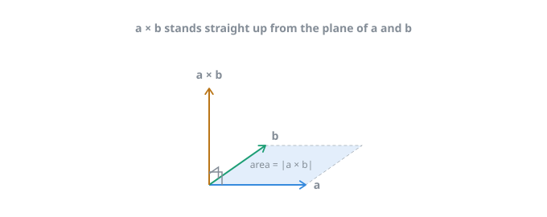
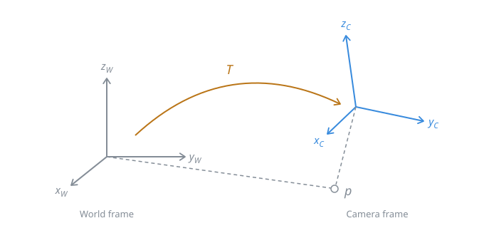

# 3D Rigid Body Motion - Chapter 2

## Summary
Study the rigid body geometry in three-dimensional space: the rotation matrix, transformation matrix, quaternion, euler angles. How to describe a rigid body's motion in a three-dimensional space. This consists of one rotation and one translation, the part where problems arise is the rotation one.

## Points, Vectors, and Coordinate Systems
The 3D space consists of three axes, however we should now consider a rigid body, which has it's position and orientation. A point is a basic element in space, a vector is an arrow pointing from one point to another. Let us also remind ourselves that we must not confuse a vector with its coordinates

### How do we describe a point in 3D space?

$$
\mathbf{a} = [\mathbf{e}_1, \mathbf{e}_2, \mathbf{e}_3]
\begin{bmatrix} a_1 \\ a_2 \\ a_3 \end{bmatrix}
= a_1 \mathbf{e}_1 + a_2 \mathbf{e}_2 + a_3 \mathbf{e}_3
$$

A base is a set of linearly independent vectos in the space
We have a base of 3 axes, here, the 3 e's can be seen as x,y,z and a's coordinates are how much each a moves each axis in a direction

### The inner product

For $\mathbf{a}, \mathbf{b} \in \mathbb{R}^3$, the inner product can be written as:

$$
\mathbf{a} \cdot \mathbf{b} = \mathbf{a}^T \mathbf{b}
= \sum_{i=1}^{3} a_i b_i
= |\mathbf{a}|\ |\mathbf{b}| \cos\langle \mathbf{a}, \mathbf{b} \rangle
$$

#### The result of the outer product can be seen as another vector who is perpendicular to the two vectors

We then write a, as a skew-symmetrix matrix, ^ will be considered a skew-symmetric symbol, a^ is skew-symmetric, its transpose equals its negative
It turns the cross product into a matrix times a vector, which is a linear operation 

$$
\mathbf{a}^{\wedge} =
\begin{bmatrix}
0 & -a_3 & a_2 \\
a_3 & 0 & -a_1 \\
-a_2 & a_1 & 0
\end{bmatrix},
\qquad
\mathbf{a} \times \mathbf{b} = \mathbf{a}^{\wedge} \mathbf{b}
$$

## Euclidian Transforms Between Coordinate Systems
Let's suppose we have a world coordinate system, and a robot, which also has its own coordinate system. We might say that that a vector in the camera system may have coordinates related to that system, same for the robot. 
The conversion between these two coordinates is done using the transform rule

Below we can see the coordinate transform. For the same vector p, its coordinates in the world and the coordinates in the camera system are different. This transformation relationship is described by the transform matrix T

The motion between two coordinate systems is also called rigid body motion, consisting of a rotation and a translation. Imagine throwing your phone in the air, its length and angle of each face will stay the same, but its initial position and rotation will change.

### The Rotation Matrix

$$
\begin{bmatrix} a_1 \\ a_2 \\ a_3 \end{bmatrix}=
\begin{bmatrix}
\mathbf{e}_1^T \mathbf{e}_1' & \mathbf{e}_1^T \mathbf{e}_2' & \mathbf{e}_1^T \mathbf{e}_3' \\
\mathbf{e}_2^T \mathbf{e}_1' & \mathbf{e}_2^T \mathbf{e}_2' & \mathbf{e}_2^T \mathbf{e}_3' \\
\mathbf{e}_3^T \mathbf{e}_1' & \mathbf{e}_3^T \mathbf{e}_2' & \mathbf{e}_3^T \mathbf{e}_3'
\end{bmatrix}
\begin{bmatrix} a_1' \\ a_2' \\ a_3' \end{bmatrix}
\overset{\triangle}{=} \mathbf{R}\mathbf{a}'
$$

It is also called direction cosine matrix, it is an orthogonal matrix with a determinant of 1 .
Since the rotation matrix is orthogonal, its transpose describes an opposite rotation

$$
\mathbf{a}' = \mathbf{R}^{-1}\mathbf{a} = \mathbf{R}^T \mathbf{a}.
$$

The coordinate transformation relationship can be simply described by using a rotation matrix R and a translation vector t.
Compared to the rotation, the translation part simply adds the translation vector to the coordinates after the rotation:

$$
\mathbf{a}' = \mathbf{R}\mathbf{a} + \mathbf{t},
$$
R turns the vector, t moves it, length and angles stay the same

## Transform Matrix and Homogenous Coordinates
The transformation relationship here is not a linear relationship, because if we make more transformations, they "compound", so to speak. For example, let's say we made two transformations $\mathbf{R}_1, \mathbf{t}_1$ and $\mathbf{R}_2, \mathbf{t}_2$:

$$
\mathbf{b} = \mathbf{R}_1 \mathbf{a} + \mathbf{t}_1, \qquad
\mathbf{c} = \mathbf{R}_2 \mathbf{b} + \mathbf{t}_2.
$$

The transformation from a to c looks like this:
$$
\mathbf{c} = \mathbf{R}_2 \left( \mathbf{R}_1 \mathbf{a} + \mathbf{t}_1 \right) + \mathbf{t}_2.
$$

### Homogenous coordinates are normal coordinates of a point, with an extra 1 added at the end

## Euler Angles 

The Euler angle provides a very intuitive way to describe the rotation since it is hard to imagine a rotation looks like only with the numbers of a rotation vector or rotation matrix

The ZYX angle is equivalent to decompose any rotation into the following three axes:
- Rotate around the Z axis of the object to get the yaw angle
- Rotate around the Y axis of after rotation to get the pitch angle
- Rotate around the X axis of after rotation to get the roll angle

In this way, we can use a three-dimensional vector to describe any rotation. Most areas have their own coordinate directions and habits when using Euler angles, not necessarily as we said here.

A major drawback of Euler Angle is that it encounters the famous Gimbal lock, when the pitch angle is over 90 degrees, it will cause the system to lose one degree of freedom. Due to this fact, Euler angles are not suitable for our task. 

## Quaternions

A quaternion has a real part and three imaginary parts, we write the real part in the front, like this:
$$
\mathbf{q} = q_0 + q_1 i + q_2 j + q_3 k
$$

where i, j, k are the three imaginary parts of the quaternion. These three imaginary parts satisfy the following relationships:

$$
\begin{cases}
i^2 = j^2 = k^2 = -1 \\
ij = k, \; ji = -k \\
jk = i, \; kj = -i \\
ki = j, \; ik = -j
\end{cases}
$$

If the real part of a quaternion is 0, then it is called an imaginary quaternion. Conversely, if the imaginary part is 0, then it is called a real quaternion. A unit quaternion is used to represent any rotation in 3D space

## Quaternion Operations
Quaternions are very similar to complex numbers, we can easily do addition, subtraction, multiplication between two quaternions, just as we would do with two complex numbers. 

## Using a Quaternion to Represent a Rotation

We can use a quaternion to express the rotation of a point. The 3D point p is rotated to become p'. If we use a matrix then there is p'=Rp. And if we use quaternion to describe rotation, how do we operate a 3D vector with a quaternion?

The first step would be to extend the 3D point to an imaginary quaternion, we can see the real part is 0:
$$
\mathbf{p} = [0, x, y, z]^T = [0, \mathbf{v}]^T
$$

We just put the three coordinates into the imaginary part and keep the real part as 0. Then, the rotated point p' can be expressed as such a product:

## Affine and Projective Transformation

In addition to the Euclidian transformation, there exist other types of transformation, from which the Euclidian transformation is the simplest. The Euclidian transformation keeps the vector's length and angle. It's like you would pick up a book, turn it, look around, and putting it some other place.The book's length and angle stay the same

### Similarity Transformation

It is similar to the Euclidian Transformation, but here we take into account a uniform scaling factor. A cube with side length 1 to be changed to side length 10, it would still be a cube.

### Affine Transformation

Any move that keeps straight lines straight and parallel lines paralel. 
Mixing any of these would result in an affine transformation:

**Rotate**

**Shift**

**Scale**

**Shear**

**Flip**

### Perspective Transformation

It is the most general transformation. The transformation from the real world to a camera photo can be seen as a perspective transformation

## Comparison of common transformation properties

| Transform name | Matrix form | Degrees of freedom | Invariance |
|:--------------:|:-----------:|:------------------:|:----------:|
| Euclidean  | $\begin{bmatrix} \mathbf{R} & \mathbf{t} \\ \mathbf{0}^T & 1 \end{bmatrix}$ | 6  | Length, angle, volume |
| Similarity | $\begin{bmatrix} s\mathbf{R} & \mathbf{t} \\ \mathbf{0}^T & 1 \end{bmatrix}$ | 7  | Volume ratio |
| Affine     | $\begin{bmatrix} \mathbf{A} & \mathbf{t} \\ \mathbf{0}^T & 1 \end{bmatrix}$  | 12 | Parallelism, volume ratio |
| Perspective | $\begin{bmatrix} \mathbf{A} & \mathbf{t} \\ \mathbf{a}^T & v \end{bmatrix}$ | 15 | Plane intersection and tangency |

## Visualizing Trajectory

Each triple is one capture. The robot (camera) moves and each triple is where it was and which way it was turned at that moment.
The colored axes are the camera's own frame and the grey axes are the reference point.
